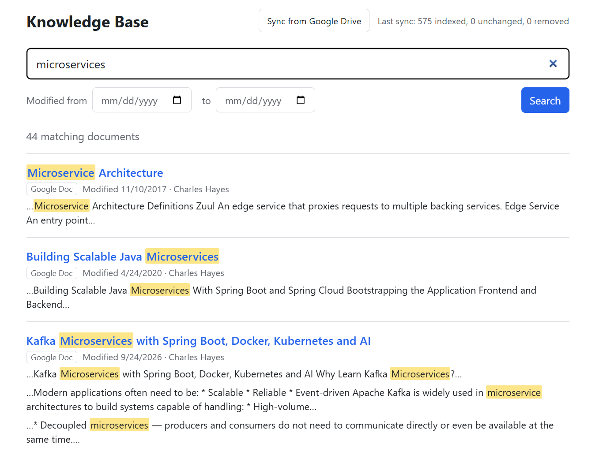

# Knowledge Base

Full-text search over the documents in your Google Drive and the Markdown files in
your GitHub repositories. A sync job reads each document's metadata and text into
Elasticsearch; the files themselves stay where they are and search results link back
to them.

You can connect either source or both.

## User Interface



## Setup

### 1. Create Google OAuth credentials (one time, Google Drive only)

1. In the [Google Cloud Console](https://console.cloud.google.com/), create a project
   and enable the **Google Drive API**.
2. Configure the OAuth consent screen and add your Google account as a test user.
3. Create an **OAuth client ID** of type **Desktop app**, download the JSON, and save
   it as `secrets/credentials.json`.

### 2. Start the stack

```bash
docker compose up -d --build
```

| Service       | URL                        |
| ------------- | -------------------------- |
| Search app    | http://localhost:3000      |
| API docs      | http://localhost:8000/docs |
| Kibana        | http://localhost:5601      |
| Elasticsearch | http://localhost:9200      |

### 3. Connect Google Drive (one time, optional)

```bash
docker compose run --rm -p 8090:8090 backend python -m app.cli auth
```

Open the printed URL in your browser and approve read-only access. The token is saved
to `secrets/token.json` and refreshed automatically afterwards.

### 4. Connect GitHub (one time, optional)

1. In GitHub, open **Settings → Developer settings → Personal access tokens →
   Fine-grained tokens** and generate a token with **Repository access: All
   repositories** and the repository permission **Contents: Read-only**.
2. Copy `.env.example` to `.env` and set `KB_GITHUB_TOKEN` to the token.
3. Restart the backend: `docker compose up -d backend`.

Every `.md` and `.markdown` file on the default branch of each repository you own is
indexed, public and private. Other files are ignored. Repositories you forked are
skipped unless you set `KB_GITHUB_INCLUDE_FORKS=true`.

### 5. Index your documents

Click **Sync documents** in the app, or run:

```bash
docker compose exec backend python -m app.cli sync
```

Sync covers every connected source. It is incremental: unchanged files are skipped,
and files removed from a source are removed from the index. Run it again whenever you
want to pick up changes. If one source fails, the other is still synced.

To index a single folder (and its subfolders) instead of the whole Drive, copy
`.env.example` to `.env` and set `KB_DRIVE_FOLDER_ID` to the ID from the folder's URL.

## Searching

All words must match by default. Use `"quotes"` for an exact phrase, `a | b` for
either term, `-word` to exclude, and `prefix*` for prefix matches.

Leaving the text empty lists documents newest first.

## Development without Docker

```bash
# backend (expects Elasticsearch on localhost:9200)
cd backend
python3 -m venv .venv && .venv/bin/pip install -r requirements-dev.txt
.venv/bin/pytest
.venv/bin/uvicorn app.main:app --reload

# frontend (proxies /api to localhost:8000)
cd frontend
npm install && npm run dev
```

Backend settings are environment variables prefixed with `KB_`; see
`backend/app/config.py`.
